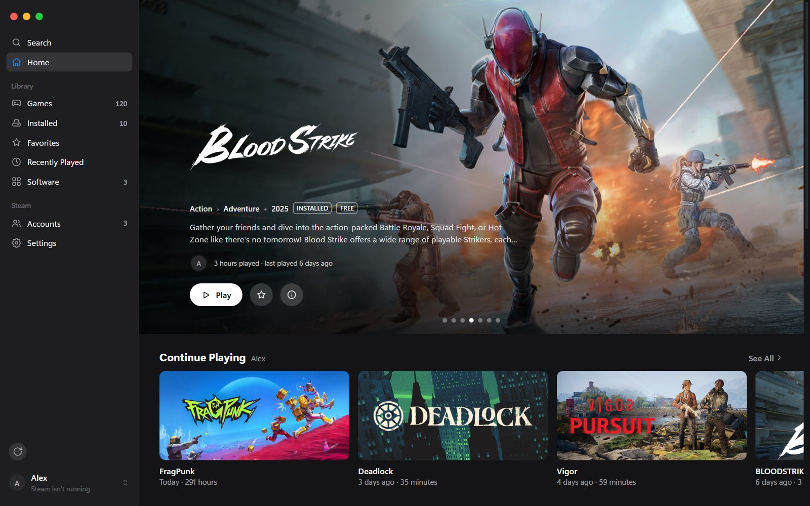
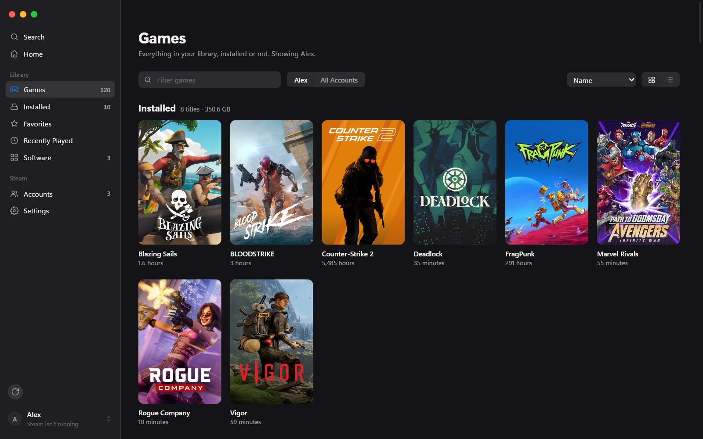
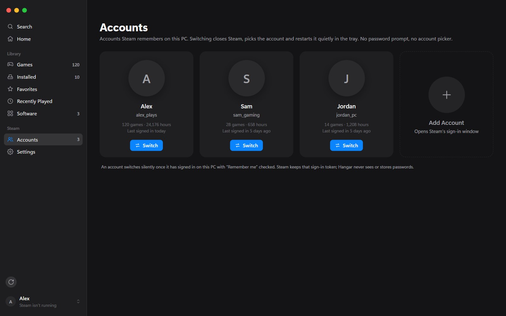

# Hangar

Every Steam account, one click away. A small native app for Windows 10 and 11, by PG.

**[Download the latest release](https://github.com/lilpatter/hangar/releases/latest)**: `Hangar_<version>_x64-setup.exe` installs it, `hangar.exe` runs without installing.

More at [lilpatter.github.io/hangar](https://lilpatter.github.io/hangar/).

## What it does

- **Silent account switching.** Changes the signed-in Steam account without the account picker or a password prompt, and sends Steam straight to the tray.
- **Play as…** A game owned by another account on this PC gets a *Play as <name>* button: one click switches accounts and launches it.
- **Your whole library.** Every game on every account, installed or not, in a grid of Steam's own cover art or a list with playtime, last played and size.
- **Favorites**, shared by every account.
- **Optional Steam Web API key** adds games an account owns but has never opened on this PC.

Hangar never reads or stores passwords. An account switches silently once it has signed in on this PC with *Remember me* checked.

## Screenshots

  
  

## Requirements

Windows 10 or 11 with Steam and the WebView2 runtime, which ships with Windows 11.

Hangar is a Windows app. There's no Mac version yet: the Mac-style sidebar and window buttons are just part of its design.

## Updates

Hangar updates itself from this page's releases and checks each download against GitHub's SHA-256 digest. Turn it off under Settings › About.

## Credits

Made by [PG](https://lilpatter.github.io).

Not affiliated with Valve. Steam is a trademark of Valve Corporation.

---

© 2026 PG. All rights reserved. Hangar is free to download and use. Its source code is not public.
